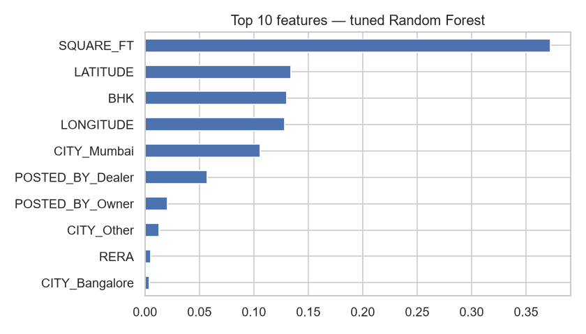
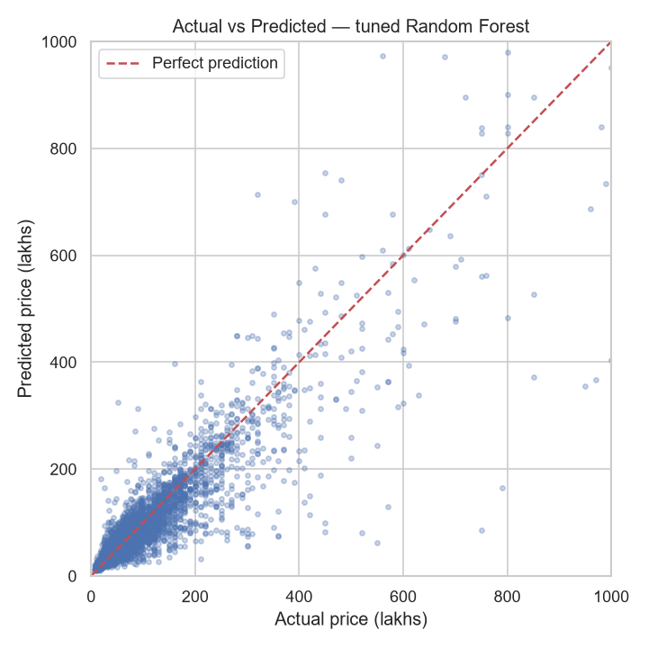
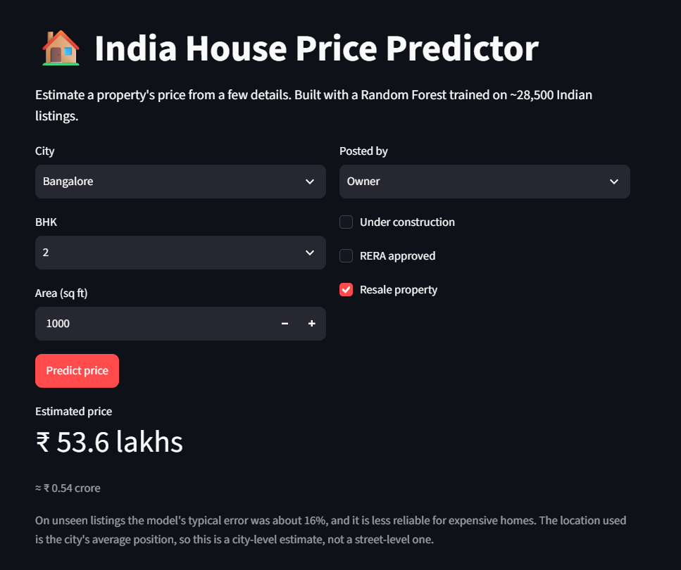
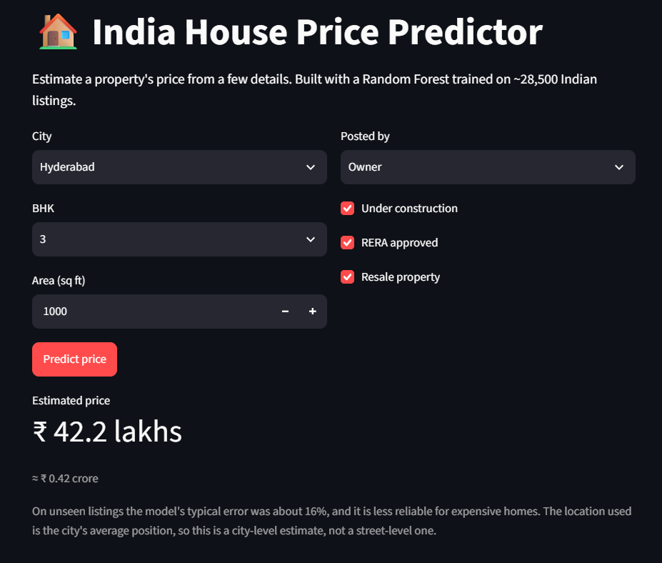
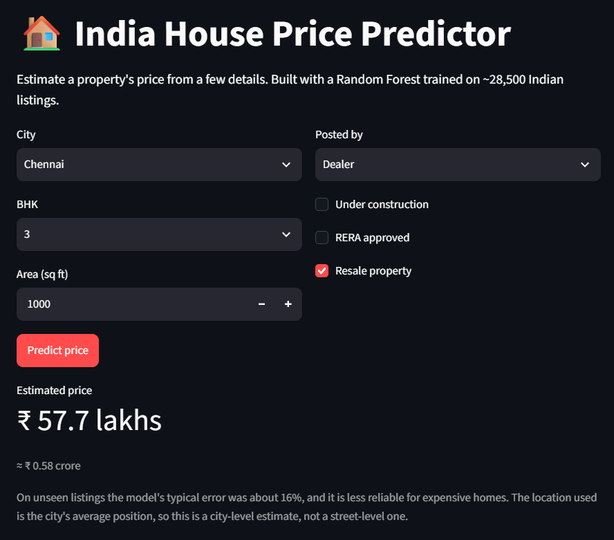

# 🏠 House Price Prediction — India

A beginner-friendly machine learning project that predicts Indian property prices (in **lakhs of rupees**) from area, BHK, city and a few listing details — with a small Streamlit app to try it.

## Dataset
House Price Prediction Challenge (India): 29,451 property listings with `POSTED_BY`, `BHK_NO.`, `SQUARE_FT`, `RERA`, `ADDRESS`, coordinates and `TARGET(PRICE_IN_LACS)`.
Original source: [Kaggle — House Price Prediction Challenge](https://www.kaggle.com/datasets/anmolkumar/house-price-prediction-challenge) (originally from a MachineHack hackathon). The dataset is licensed GPL-2.0 by its original authors and is **not redistributed here** — see [`data/README.md`](data/README.md) for how to download it.

## What the project does
1. Explores the data and finds its problems: duplicates, extreme outliers, swapped latitude/longitude columns, and an area column that looks derived from price
2. Cleans it (see the removal counts below)
3. Assigns each listing to a city using its **coordinates** (the last word of the address is unreliable)
4. Predicts `log(1 + price)` because prices are heavily skewed
5. Chooses a model with **5-fold cross-validation** on the training data only, then tunes a Random Forest with `GridSearchCV`
6. Evaluates on a held-out test set **once**, at the end
7. Saves a self-contained model that the Streamlit app loads

## Cleaning
Rows: 29,451 → 29,050 after removing duplicates → **28,517** after removing outliers. The limits are judgement calls from inspecting the data, not official rules:

| Rule | Rows flagged |
|---|---|
| Area outside 200–10,000 sq ft | 221 |
| Price outside 5–5,000 lakhs | 154 |
| More than 6 BHK | 42 |
| Coordinates outside India | 255 |

The rules overlap, so 533 unique rows were removed.

## Results

**Model selection (5-fold CV on training data, R² on log price):**

| Model | CV R² (mean ± std) |
|---|---|
| Random Forest | 0.819 ± 0.009 |
| Gradient Boosting | 0.803 ± 0.008 |
| Linear Regression | 0.653 ± 0.024 |

Tuned Random Forest (`min_samples_leaf=3`, `max_features=0.5`): CV R² 0.825. Gradient Boosting was not tuned.

**Final test-set result (used once):**

| Metric | Value |
|---|---|
| R² on log price | 0.840 |
| R² on price in lakhs | 0.799 |
| MAE | 22.8 lakhs |
| RMSE | 58.8 lakhs |

> R² is reported on two scales. The log-price R² is the one used for training and model selection; the lakhs-scale R² is the one that matches rupee prices. Both are valid; they are just different numbers.

> **Caveat:** `SQUARE_FT` appears to be calculated from the price (every listing's price ÷ area is a whole number of rupees per sq ft, but only ~10% of areas are whole numbers). So these scores are probably more optimistic than what you would get with areas that people measure and type in themselves.

**Where the model is weak:**

| Actual price (lakhs) | Listings | MAE (lakhs) | Median % error |
|---|---|---|---|
| Under 50 | 2,309 | 8.3 | 18.3% |
| 50–100 | 1,893 | 13.9 | 13.8% |
| 100–200 | 1,002 | 28.6 | 15.6% |
| Over 200 | 500 | 111.7 | 21.1% |

Percentage error stays fairly steady, but errors in lakhs grow quickly for expensive homes, and a few large misses on luxury listings drive the RMSE up. The data has no building age, floor, amenities or exact locality quality, which are what separate expensive homes from each other.




## App demo
<p>
  
  
  
</p>

## Project structure
```
house-price-prediction-india/
├── app.py                                  # Streamlit app
├── src/predict.py                          # loads the model and predicts
├── data/README.md                         # how to download the dataset (not included)
├── notebooks/house_price_prediction.ipynb  # full walkthrough
├── images/
├── models/house_price_model.joblib         # self-contained model bundle
├── requirements.txt
├── LICENSE
└── README.md
```

## How to run
Use a recent Python (3.11 or newer). The saved model is a pickle made with scikit-learn 1.9.1, so on a different scikit-learn version it may warn or fail to load. If that happens, run the notebook once: it retrains the model and re-creates `models/house_price_model.joblib` for your setup.
```bash
pip install -r requirements.txt

# first, download the dataset into data/ (see data/README.md)

# explore and retrain (re-creates models/house_price_model.joblib)
jupyter notebook notebooks/house_price_prediction.ipynb

# launch the app (run the notebook first if the model fails to load)
python -m streamlit run app.py
```
## What I learned
- **Honest evaluation:** My first version chose a model using the test set, which inflated the score. Choosing with cross-validation and using the test set once gave a lower, more honest number.
- **Cleaner isn't always better:** A messy address-based city label (it called much of greater Mumbai "Lalitpur" or "Maharashtra") scored a CV R² of about 0.84. My coordinate-based city scored about 0.82, the same as having no city feature. The coordinates are probably already doing that job. I still can't explain why the messy label carried extra signal, and I kept the coordinate-based version because it gives readable city names in the app.
- **One score hides failures:** Splitting errors by price band showed that errors in lakhs grow quickly for expensive homes, even though the percentage error stays fairly steady.
- **Checking the data itself:** Price ÷ area is always a whole number, so area was almost certainly calculated from price. That means my scores are probably optimistic.
- **Saving a usable model:** The saved file has to include everything needed to predict (feature columns, city coordinates), or it only works inside the notebook.

## Limitations & next steps
- `SQUARE_FT` looks derived from price (see the caveat above).
- City centres and radii are approximate values I chose; cities with fewer than 100 listings are grouped as "Other", which the app labels as a rough estimate.
- No data on building age, floor or amenities.
- Next: XGBoost/LightGBM, tuning Gradient Boosting too, locality-level features.

## License
The code in this repository is MIT licensed — see [LICENSE](LICENSE). The dataset is separate and is licensed GPL-2.0 by its original authors.
